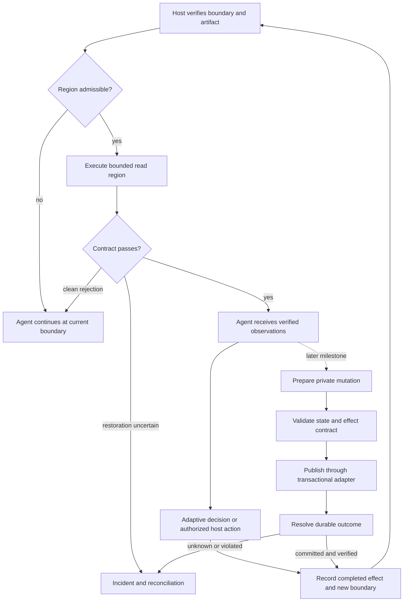

# GAC expansion: a generic optimizer for adaptive agentic workflows

Status: proposed design and execution plan; no expansion is implemented by this document.

Date: 2026-11-07.

Source baseline: `origin/main` at `5250a32ffd7862da9d602326b6497c8b2aa2d97d`.

Scope: expand what GAC can optimize while preserving explicit effect, continuation, and evidence boundaries. This is a separate research and engineering track, not a claim that the current paper already supports write-enabled compilation.

## 1. Decision and intended outcome

The architectural goal is a reusable optimizer for generic agentic workflows: different domains, tool catalogs, model providers, and host runtimes should share the same discovery, bounded compilation, admission, and execution contracts. GAC should accommodate workflows containing reads, writes, branches, loops, and adaptive model decisions even when only some regions are eligible for compilation. Generic applicability does not imply universal compilability, automatic correctness, or guaranteed savings. The current implementation does not yet establish this broader capability.

The expansion should proceed through independently useful stages:

1. Establish whether real adaptive traces contain useful, groundable recurring regions that the current boundary restrictions exclude.
2. Support read-only regions at explicitly verified interior workflow boundaries, including after an ordinary agent write has completed.
3. Compile bounded mutations inside one owned transactional boundary, with validation before publication and durable recovery across publication.
4. Consider external writes only for adapters with enforceable authorization, concurrency, deduplication, and outcome-reconciliation contracts.

Do not begin by making `WRITE_REVERSIBLE` compilable. A reversible business operation, a discardable private mutation, and an externally visible operation with compensation have different semantics. An effect name alone cannot justify retry, fallback, or publication.

The first useful deliverable is an adaptive agent that alternates between admitted compiled read regions and ordinary agent decisions/actions. The first compiled-write deliverable is deliberately smaller: one transactional backend, a bounded program, and one publication point. Cross-service transactions, autonomous compensation planning, unrestricted generated Python, and arbitrary concurrent write branches are deferred.

Success has three separate meanings: **mechanism correctness** under a stated backend contract; **empirical task performance** on a fresh population; and **incremental value of automatic guarded compilation** over simpler alternatives. Passing one does not establish the others.

## 2. Current implementation and evidence

The following observations were checked against the source baseline above. Links identify existing implementation or retained evidence, not promised future capabilities.

| Area | Current behavior | Consequence for expansion |
|---|---|---|
| Effects | [`EffectSpec.compilable`](src/guarded_agentic_compaction/schema/effects.py) requires a read-like effect, speculation and replay capabilities, and no approval requirement. Write classes already exist but are barriers. | Preserve this default. Introduce separately versioned execution contracts for new modes. |
| Candidate regions | [`GrcConfig.prefix_only`](src/guarded_agentic_compaction/grc/compile.py) defaults to true; [`windows.py`](src/guarded_agentic_compaction/graph/windows.py) rejects write and unknown effects. | Disabling `prefix_only` alone would not make interior execution valid. |
| Dispatch position | [`Dispatcher.decide`](src/guarded_agentic_compaction/runtime/dispatch.py) normally requires position zero. An exact declared [read-only prologue](src/guarded_agentic_compaction/runtime/prologue.py) is the narrow exception. | A completed write cannot be smuggled into that exception. Interior boundaries need a new contract and adapter support. |
| Control flow | [`program.py`](src/guarded_agentic_compaction/grc/program.py) and [`interp.py`](src/guarded_agentic_compaction/runtime/interp.py) support per-call typed predicates and bounded repeated calls. | Branching is not entirely new. Arbitrary nested control-flow graphs and general loop bodies are not established by these primitives. |
| Exceptions | [`ToolFacade`](src/guarded_agentic_compaction/runtime/facade.py) wraps executor exceptions as `ToolFailure`, under a pre-commit `FacadeError` contract. | Reusing this contract for writes could replay a successful mutation after a timeout. |
| Staging | [`Staging`](src/guarded_agentic_compaction/runtime/staging.py) compares explicit snapshots and accepts only read-like effects at commit. | Its `commit` records an accepted read execution; it is not a durable database transaction coordinator. |
| Admission | Compiler and artifact structures retain guards, verifier checks, evidence, and compatibility versions. | New boundaries, effects, loss definitions, and continuation policies require fresh artifacts and evidence. |

The [browser development boundary](paper/supplementary/browser-boundary-development.md) retains an owned application/browser instance after a checked read and allows subsequent local writes. It explicitly distinguishes this research mechanism from production `Staging` and GAC admission. It does not establish arbitrary browser restoration or admitted compiled writes.

The [AppWorld adaptive pilot](paper/results/appworld_adaptive_viability/REPORT.md) discovered a grading-path persistence defect and retained the interrupted run as development evidence. The [common-entry preflight](paper/results/appworld_entry_preflight/REPORT.md) subsequently validated controls with common authentication setup; authentication remained a write. The [batched competence report](paper/results/appworld_batched_competence/REPORT.md) records 1/12 and 2/12 successes against a prespecified 8/12 development gate. That gate failed. These exposed tasks can support engineering regression checks, not fresh confirmation or a presumption of a competent comparator.

The [three reviewer reports](paper/reviews/ICLR-1.txt), [including the adaptive-workflow objection](paper/reviews/ICLR-2.txt) and [selection/coverage objection](paper/reviews/ICLR-3.txt), motivate measuring continuation outcomes, accounting for the eligible population, and comparing equally capable alternatives. Adding writes alone does not resolve those objections.

## 3. Requirements, assumptions, and exclusions

### Functional requirements

- Discover recurring regions from actual agent traces, preserving failed attempts and explicit model boundaries. Reference programs are execution controls, not a substitute for agent discovery data.
- Dispatch only at host-attested boundaries compatible with the exact artifact, principal, tenant, workflow state, and continuation.
- Compile grounded arguments and predicates over observable values. Leave unresolved semantic decisions with the model.
- Permit repeated entry into qualified regions without replaying earlier effects or silently resetting the interaction budget.
- For compiled mutations, distinguish preparation, publication, unknown outcome, recovery, and continuation.
- Produce enough durable evidence to explain what was attempted, committed, rejected, resumed, or left unresolved.

### Generic core and adapter boundaries

Keep business-specific rules, API names, authentication mechanisms, and storage details outside the compiler core. A workflow supplies typed schemas and reviewed contracts; the compiler discovers admissible recurring structure rather than choosing from task-specific hardcoded recipes. The proposed integration interfaces are:

| Interface | Responsibility |
|---|---|
| Trace adapter | Normalize genuine model boundaries, calls, observations, arguments, provenance and effect receipts without inventing missing decisions or outcomes |
| Workflow host adapter | Attest region entry, expose scoped live-ins, preserve history/budgets, and resume at a durable continuation cursor |
| Tool/effect adapter | Expose typed operations, resource scopes, authorization and enforceable capabilities; unknown capabilities default to refusal |
| Mutation/recovery adapter | Implement prepare, publish, outcome query and recovery semantics for a particular backend; present explicit unsupported capabilities |
| Evaluation adapter | Independently grade the workload's final answer, persisted state and allowed effects for discovery validation, calibration and testing |

The core consumes these contracts and a bounded region IR; it must not contain checks for GitHub, Reddit, AppWorld, or a particular task ID. Domain-specific validators and effect catalogs are legitimate adapter inputs. Human effort to author and maintain them is measured as an integration cost.

Expose separate support states: `HOST_COMPATIBLE`, `REGION_INELIGIBLE`, `CANDIDATE_UNADMITTED`, and `ARTIFACT_ADMITTED`. These are proposed reporting concepts, not existing enum values. A compatible host may produce no admitted region and still run its ordinary workflow. If the host cannot capture required state, GAC stays off on that surface; if publication becomes uncertain, compatibility does not permit unsafe fallback.

The initial PostgreSQL example is an execution-contract testbed, not the product scope. Before claiming architectural portability, run a shared conformance suite against at least two structurally different host/tool integrations, with one demonstrating interior read reuse and one demonstrating a mutation-capable boundary. Register schemas/adapters without editing core domain logic. This is a portability check, not proof of performance across all workflows. A host may support concurrent agents externally; the first optimized regions must be isolated from their conflicting effects or refuse dispatch.

### Nonfunctional requirements and trusted components

The host adapter, effect catalog, authorization service, backend transaction/deduplication behavior, and evaluation oracle are trusted and versioned components. Model output and tool-returned text cannot grant permissions or attest a boundary. A compromised trusted backend is outside the initial guarantee; schema/effect drift is within the required detection and refusal scope.

The initial implementation has one logical owner per workflow activation and serial execution inside each compiled region. It must survive process termination and duplicate delivery; a single-process assumption cannot justify unsafe replay. Calls, loop iterations, recovery attempts, wall time, and spending have hard bounds. All attempted work remains charged, including discarded staging and reconciliation.

No production availability or throughput target is invented here. M0 must measure candidate lengths, entry frequency, backend latency, and expected reuse. M3 must establish journal and reconciliation capacity before enabling concurrent workers. No live production writes or paid study are authorized merely by accepting this plan.

### Explicit exclusions from the first release

- No whole-agent compilation, unbounded loops, dynamic tool resolution, or arbitrary model-generated executable code.
- No financial transfers, public messaging, destructive production changes, or multi-service sagas as initial compiled-write demonstrations.
- No automatic Git merge or deployment. A coding workflow may prepare changes on a dedicated branch and create a reviewable PR through an authorized host action; the user retains final merge authority.
- No reuse of old read-only certificates to certify mutations, new entry positions, or changed continuation behavior.
- No claim of exact global restoration when logs, quotas, credentials, notifications, time, or other effects remain observable.

## 4. Execution model: regions separated by decisions and commitments

“Continue at current boundary” means preserve all previously completed work and resume the remaining workflow. It never means restart the episode after an earlier write. Even a rejected read attempt may consume quota or change session state; the existing strict fallback contract applies unless a separately named and validated continuation mode permits those differences.

GAC remains an optimizer of an existing host workflow. The host owns adaptive reasoning, authorization and approval interactions, durable workflow identity, and externally visible action policy. GAC owns region discovery, bounded synthesis, admission, dispatch, and execution evidence. Reuse an existing host's durable execution facilities when they meet the contract; avoid creating a general workflow engine merely to optimize regions.

## 5. A new interior-boundary contract

Define a proposed `RegionBoundary` supplied by the trusted host. Its minimum fields are:

| Field group | Required meaning |
|---|---|
| Identity | Workflow instance, region identity, activation ordinal, checkpoint generation, and artifact version. A loop's second visit is a new activation; a retry of the same visit is not. |
| Control position | Allowed predecessor transition and the exact current program point. A tool-name prefix or approximate history match is insufficient. |
| State and inputs | Typed live-ins with provenance, resource identities, version/read-set tokens, and freshness constraints. |
| Prior effects | Durable receipts for completed predecessor effects and explicit status of outstanding actions. No unresolved earlier write is permitted at an ordinary dispatch boundary. |
| Authority | Tenant, principal, policy version, capabilities, and scoped approval reference when required. Credentials themselves are not durable trace payloads. |
| Continuation | History-policy version, model/tool manifest, pending call IDs, resume cursor, consumed budgets, and observation-delivery status. |

A host signature or trusted in-process provenance authenticates the descriptor, but does not prove that its content captures all relevant state. Each adapter must document its observable scope and demonstrate the correspondence through exact-path controls. Incomplete state coverage blocks the proposed mode.

Discovery and calibration must use the same boundary representation and host behavior as deployment. Update region mining, dispatcher selection, artifact serialization, execution manifests, and every enabled host adapter together. An artifact valid at the initial boundary remains initial-only. The read-only prologue mechanism remains unchanged.

For the first interior implementation, permit only a bounded, serial sequence of host-declared region positions. A write invalidates affected observations and dependent predicates. Unknown aliasing or an unversioned dependency causes conservative invalidation. A newly refreshed value must not inherit an old provenance receipt.

## 6. Branches and loops: preserve the decision boundary

The first control-flow expansion should reuse existing typed predicates and bounded loops where possible. Examples include “fetch the next page while `has_more` is true” and “read additional metadata when a returned field is absent.” A branch such as “this complaint deserves a refund” remains a model or explicit policy decision unless a separately validated observable rule actually represents that decision.

Require definition-before-use on every path, typed joins, explicit absent outputs, stable entity identity, and branch-specific postconditions. A missing or malformed value must not silently choose a write branch through an operator default. Unsupported predicates or ambiguity must refuse before publication.

For loops, enforce both a static maximum and runtime call/resource budgets. Check target identity and preconditions on every iteration. The first mutation program may make multiple bounded changes within one transaction but has one publication point; partial externally visible loop progress is deferred to a later recovery design. Exceeding the bound aborts unpublished work. A bound failure after publication is a recovery event, never a clean rejection.

Trace support for one branch says nothing about an unobserved branch. Explicitly enumerate reachable branches in the bounded program, challenge each permitted branch, and refuse unsupported paths. Development branch coverage is an engineering check, not an independent-sample risk certificate. New nested branching or loop-body syntax requires a separate expressivity justification and review after the initial milestones.

## 7. Mutation contracts and publication

Introduce a proposed `MutationContract` referenced by an artifact and enforced by an adapter. Its fields include backend and resource identity; allowed operation and field changes; authorization; argument provenance; transaction scope; preconditions/read set; desired state relation; allowed secondary effects; publication protocol; retry/deduplication scope and retention; authoritative outcome query; and recovery owner.

Treat effect classification and execution capability as separate axes:

| Operation | Required execution property | Allowed recovery |
|---|---|---|
| Private workspace mutation | Owned filesystem/container, restricted mounts and network, no escaped effects, explicit discard/close contract | Discard before publication; retain real costs |
| Single-backend transaction | All relevant reads and writes share adequate isolation; durable operation receipt and business changes commit atomically | Abort unpublished transaction; reconcile uncertain commit |
| External idempotent operation | Backend-enforced stable operation identity, request-payload validation, documented retention, authorization, and adequate conditional update/outcome APIs | Retry the same operation only within its contract; otherwise reconcile or stop |
| Compensatable external operation | Application-specific compensator with its own authorization, preconditions, durable outcome and failure policy | Compensation is a separate state transition; never claim original-state restoration |
| Unknown or irreversible external effect | No sufficient recovery contract | Keep outside automatic compiled execution |

`WRITE_REVERSIBLE` alone satisfies none of these rows. A sandbox is also not a production transaction: success in a cloned backend cannot be “published” to a live service without revalidating live assumptions and performing a real commit.

For the initial backend, prefer a local PostgreSQL fixture with an application-owned schema, restricted roles, no external triggers/functions, and application-generated identifiers. Use serializable transactions or a reviewed equivalent that covers the entire relevant predicate/read set; per-row version checks alone do not protect aggregate invariants or phantom reads. Keep model reasoning outside open transactions. If a plan was prepared earlier, revalidate all inputs on which its decision depends inside the publication transaction. PostgreSQL documents both isolation differences and the fact that sequence changes are not rolled back; the prototype must account for that rather than claim full database restoration. [PostgreSQL transaction isolation](https://www.postgresql.org/docs/current/transaction-iso.html).

A mutation verifier checks a state transition and effect envelope, not just response text. It must constrain the target identity, fields and rows touched, business invariants, returned outputs, allowed secondary effects, and continuation receipts. For an “add existing items to a collection” fixture, check ownership, allowed item IDs, duplicate policy, untouched collections, and the exact allowed membership delta. Verifying only that the requested items now exist would miss unwanted deletions or edits elsewhere.

Pre-publication validation prevents publication of detected invalid private state. Post-publication verification detects defects but cannot retroactively prevent their effects. A post-publication mismatch freezes the artifact and enters recovery; it is not counted as harmless abstention.

### Compiler work required beyond the transaction adapter

M2 must extend trace capture, resource-dependency analysis, region mining, synthesis, contracts, and execution together. A durable executor alone is not a write compiler. Preserve read-after-write, write-after-read, and write-after-write dependencies at resource/alias scope; unknown conflicts keep operations ordered or make the region ineligible. An effect multiset cannot capture ordering, target identity, or transaction boundaries. Add an ordered effect/commit description with branch-specific allowed transitions.

Learn argument bindings only from witnessed, properly scoped values and use reviewed operation semantics. Do not infer authorization, compensation, business invariants, or reversibility from recurring successful traces. Existing argument canonicalization must be re-audited for mutations: a transformation safe for retrieval, such as widening a set of results, may change the intended write targets. A generated mutation must pass the semantic state-transition oracle on fresh disposable development worlds before admission is considered. Recorded-response replay cannot validate actual write effects.

## 8. Durable outcome and recovery protocol

Use an operation identity based on tenant, workflow instance, region activation, logical step/iteration, and an explicit business intent identity. Retries and baseline recovery of the same action preserve that identity. Store the request digest and artifact version with it; changing an artifact must not silently allocate a fresh identity to an unresolved action. Distinct intentional repetitions receive distinct activation/intent identities.

Persist an operation record containing the identity, request digest, authorization scope, preconditions, transaction/backend identifiers, attempt metadata, result receipt, and delivery status. Protect secrets through references and scoped encrypted storage. For the first transactional backend, the committed receipt and business mutation must be atomic in the same database transaction. A durable intent record can precede it, but intent alone never proves completion.

| State | Required fact | Next action |
|---|---|---|
| `PREPARED` | Intent recorded; publication has not been attempted | Validate or abandon private work |
| `COMMITTING` | Publication attempt is durably recorded; outcome may be unknown after a crash | Publish under the adapter contract or query authoritative outcome |
| `COMMITTED` | Authoritative durable receipt exists | Verify postconditions, record continuation, deliver result |
| `ABORTED` | Authoritative evidence excludes commitment and late completion | Resume at the same workflow boundary or create a new authorized plan |
| `UNKNOWN` | A request may have committed, or may still complete | Block dependent actions; reconcile under a bounded policy |
| `INCIDENT` | Contract violation, incompatible state, or unresolved outcome exceeds the recovery policy | Freeze new affected dispatch; retain evidence and hand off recovery |

Required rules:

1. Write intent before issuing an external action. If journal persistence fails, issue nothing.
2. Timeouts, cancellation, connection loss, and worker death are not evidence of nonexecution. A remote action can complete after the caller stops waiting.
3. An authoritative “not found” must have sufficiently strong consistency and exclude still-running/late requests before it licenses a fresh attempt. A list/search endpoint with eventual consistency is insufficient.
4. Retry only when the backend enforces the operation identity or a transaction proves no commitment. Preserve the same payload and identity; reject a mismatched payload. AWS describes why server-side deduplication and atomic recording matter. [Idempotent API design](https://aws.amazon.com/builders-library/making-retries-safe-with-idempotent-APIs/).
5. Deduplication retention must exceed the permitted recovery window. Expired or unverifiable retention blocks blind retry. Never claim end-to-end exactly-once execution from a client-side log.
6. Concurrent recoverers must not both own an action. Use a durable claim plus backend-enforced fencing, uniqueness, or compare-and-set as appropriate. A lease alone cannot stop a stale worker from writing.
7. Deliver a committed observation with a stable receipt ID and persist the continuation cursor. If a crash occurs after publication but before delivery, redeliver the receipt without repeating the action. The host must deduplicate downstream actions across repeated delivery.
8. A kill switch stops new publication attempts but does not cancel already accepted remote effects. Reconciliation remains available after retirement or upgrade.

Authorization is evaluated before publication using current policy and the actual target. Approval, if required, binds to the intent, payload, resource/version constraints and expiry; changing them invalidates approval. Waiting for approval does not hold a database transaction open. Recovery reads and already-authorized operation reconciliation have explicit privileges; a permission failure must not be misreported as an absent operation.

Compensation is deferred. If later supported, it must preserve concurrent legitimate changes and expose its own failure outcome. It cannot retract every notification or observation caused by the original action. [Compensating transaction pattern](https://learn.microsoft.com/en-us/azure/architecture/patterns/compensating-transaction).

## 9. Correctness claims and statistical admission

Keep the following obligations separate:

**Execution obligation.** Under the documented host/backend assumptions, an unauthorized call is blocked before execution; unpublished mutations stay inside the owned boundary; uncertain publication never becomes ordinary fallback; completed actions are not blindly repeated; and all recovery paths terminate or enter a visible incident within configured bounds. These are design and implementation obligations checked through state-machine analysis and adversarial tests. Finite testing alone is not a universal proof.

**Semantic obligation.** The compiled region preserves the specified task state transition and continuation behavior, including relevant effects. Runtime shape/provenance checks are not sufficient to prove semantic task correctness. Reference replay is useful for development; an independent task oracle must grade final persisted state and final answers through the actual adapter path.

**Empirical admission obligation.** Freeze the candidate, host adapter, entry contract, continuation, routing/threshold rule, loss, sampling frame, and multiplicity treatment before fresh calibration. Sample before filtering on baseline success or region occurrence; every member of the declared deployment population needs a disposition. Keep no-match cases, rejection, fallback, infrastructure failures, unknown outcomes, and incomplete runs visible.

Specify the denominator for each claim. Full-workflow quality includes all scheduled members of the sampled population, including fallback. Conditional risk among optimized episodes uses the frozen selection policy and the corresponding selected groups; low coverage cannot establish that conditional risk by diluting failures with baseline-only cases. Infrastructure failures receive a prespecified conservative disposition, never silent exclusion. Report both unconditional workflow outcomes and conditional optimization outcomes with their own uncertainty and coverage.

Measure at least these distinct outcomes: absolute final task failure; compiled-only failure against the paired unchanged agent; effect-contract violation; unresolved publication; and complete workflow cost. Both arms failing is not evidence of adequate quality. A clean refusal can be a successful mechanism outcome while the resulting full workflow still fails. Do not label post-commit defects as abstentions or drop them because no final answer was produced.

A fixed-candidate certificate does not automatically cover a selected portfolio, repeated adaptive region activations, or changing routing. Per-region error probabilities cannot simply be added unless their conditional validity over encountered histories and the activation bound are established. The first empirical release should therefore calibrate and evaluate the **whole frozen bounded orchestration policy** on independent task groups. Per-region results remain diagnostic until a composition argument is specified and reviewed.

For a zero-violation fixed-policy calibration sample of size `n`, the one-sided exact binomial upper bound is `1 - alpha^(1/n)` under independent Bernoulli sampling. A prespecified union-bound treatment for `m` tested policies/thresholds replaces `alpha` by `alpha/m`; it does not repair adaptive reuse of holdout data or dependence. Use this only as a feasibility calculation, not a claim that future data will contain zero violations. Choose the target loss margin and confidence level before running; report no-go if the available independent groups cannot support them. Do not copy a historical sample threshold without recomputing its assumptions.

Task variants, repeated seeds, shared scenario templates, and correlated retries do not create new independent groups. Predeclare a defensible grouping and group-level loss/estimand or a justified dependence-aware analysis. For paired task success comparisons, predeclare the noninferiority margin and paired analysis; absence of a significant difference is not noninferiority. Safety-critical effect constraints remain hard requirements even if average task quality is acceptable.

## 10. Evaluation program and meaningful comparators

Use two tracks. A provider-free controlled fixture establishes execution semantics, fault handling, and state/effect oracles. A separate adaptive agent workload evaluates usefulness. Handwritten fixture programs can validate the executor but cannot demonstrate automatic discovery or model-call savings.

Select adaptive workloads prospectively using public task metadata and development-only evidence. Require substantial model decisions between recurrent regions, a competent unchanged baseline, useful automatically synthesized candidates, sufficient fresh groups, and an oracle that checks actual side effects. The current AppWorld and browser development tasks remain exposed; neither is automatically approved as the final workload. Common authentication/setup must be identical and charged across arms. Benchmark-specific rules and adapted entry conditions must be disclosed.

Compare:

| Arm | Purpose |
|---|---|
| Unchanged adaptive agent | Establish task competence and total workflow cost |
| Handwritten bounded workflow/composite | Test whether equivalent manual optimization explains the benefit |
| Simpler compiler using the same IR, tools, boundaries, transaction adapter and budgets | Isolate the value of GAC's discovery/admission rather than infrastructure advantages |
| Full GAC | Evaluate the frozen automatic selection and guarded execution policy |

Add support-only versus learned-selection comparisons only when development feasibility supports at least two positive certified coverage levels on a common held-out population. Keep risk budgets and threshold-search accounting equal. If this is infeasible, report the limitation instead of promising a learned-gate result. Unsafe compiler ablations run only in controlled disposable environments; production controls are never removed to manufacture a comparison.

Pair arms on equivalent isolated initial states; freeze model, prompt/history policy, tool catalog, initialization, limits, oracle, and sampling weights. Randomize or balance execution order where drift matters. Do not replay a previous model answer and call it fresh adaptive continuation. Preserve candidate generation failures and the full rejection funnel, including all admitted and retired families.

Report task success, effect correctness, incident and unknown-outcome rates, coverage by workflow boundary, end-to-end fallback success, model/tool calls, p50/p95 latency, total tokens/cost, and recovery work. Separate normal workloads from injected-fault workloads. Include preparation, validation, discarded attempts, reconciliation, setup, offline discovery/calibration, maintenance, and human authoring effort where measured. Unpriced costs remain explicit.

The reuse break-even calculation is `N > offline_cost / (baseline_per_run_cost - optimized_per_run_cost)` only when the denominator is positive and the workload/maintenance assumptions hold. A one-call saving can be erased by state hashing or transaction overhead. Freeze a realistic expected reuse horizon before using break-even as a go criterion. Feature support without economic benefit is a valid outcome.

## 11. Implementation milestones and stop/go decisions

Each row is a separate reviewable PR or small PR series. Estimates are rough engineering effort for one experienced maintainer with existing infrastructure, not delivery commitments or experimental sample-acquisition estimates. Re-estimate after M0. No PR is merged automatically.

| Milestone | Deliverable and primary code areas | Exit gate | Rough effort |
|---|---|---|---|
| M0: feasibility and specification | Inventory actual traces and rejection reasons; define one interior-read use case and one transactional mutation use case; audit adapters; freeze state-machine and oracle specs. Start from `graph/windows.py`, retained reports, and host runners. | Useful recurrence and observable live-ins demonstrated in development; exact execution/grading controls pass; a plausible fresh-data and reuse budget exists. Otherwise narrow or stop the track. | 3–5 person-days |
| M1: interior read regions | Versioned boundary schema/manifests; matching discovery/dispatch; current-boundary continuation and history delivery; one host adapter. Touch `schema/traces.py`, `schema/artifacts.py`, `grc/compile.py`, `runtime/dispatch.py`, `runtime/runner.py`, and relevant integrations. | Prefix regressions pass; wrong-position, stale-input, prior-write, duplicate-delivery and unsupported-host cases refuse correctly; end-to-end continuation is exercised. | 7–12 person-days |
| M2: owned transactional writes | Separate mutation artifact/mode; ordered resource/effect dependencies in mining and synthesis; one restricted PostgreSQL adapter; bounded program and state-transition verifier; durable intent/receipt with atomic business publication. Extend `graph/windows.py`, `grc/synthesize.py`, `grc/contracts.py` and schemas; add proposed `runtime/transactions.py`, `runtime/journal.py` and backend-specific code. Keep existing read facade semantics unchanged. | Every publish path has a resolved or explicit unknown outcome; invalid private state never publishes; crash/restart and concurrency controls pass; automatic mutation synthesis works on development traces; no read-only artifact is silently upgraded. | 15–25 person-days |
| M3: one external write adapter, conditional | Backend capability audit, request identity, reconciliation, credential handling, revocation, and fencing/deduplication tests. Extend the journal contract through one explicit adapter. | Service actually supplies required semantics under documented failure/retention assumptions. If not, leave its writes with the host agent. | 10–20+ person-days if feasible |
| M4: portability and fresh adaptive comparison | Validate common contracts on a second structurally different integration; freeze candidate(s), complete orchestration policy, splits, admission loss, comparator parity, sample-size analysis, budget, and analysis scripts. Start empirical work with the smallest relevant M1 or M2 capability; M3 is not a prerequisite. | Portability claims require both integration conformance checks; performance claims separately require competence, discovery and affordable independent samples. Run the frozen design and retain negative results. | 8–15 person-days for integration/harness; acquisition cost and duration assessed separately |
| M5: limited adoption and maintenance | Read-only shadow selection, isolated mutation trials, then opt-in canary for eligible adapters; telemetry, retirement and recovery runbooks. | Defined operational limits, responsible recovery owner, and evidence for the intended deployment scope. No uncontrolled write shadowing. | 5–10 person-days, scope-dependent |

M0 may approve only M1 if transactional writes offer no useful recurrence. M1 and M2 do not require external services. M4 can begin after the relevant engineering gates pass; completing M3 is not necessary to study adaptive workflows. Cross-service compensation, parallel write branches, broader DSL syntax, and a general durable workflow service require a new plan after demonstrated need.

## 12. Required validation matrix

Future implementation PRs must test effects and durable state, not merely returned status codes. Use an independent observer and the actual host-to-backend-to-grader path. Deterministic fixtures and bounded state-machine exploration should cover crash points; randomized testing supplements them.

| Scenario | Required observation |
|---|---|
| Wrong boundary, changed tenant/principal, stale manifest, missing provenance | No optimized tool invocation and no write |
| Same core used through two different host/tool adapters | Shared conformance rules pass without task-specific branches in the compiler; unsupported capabilities are explicitly refused |
| A read region follows an earlier successful write | Rejection resumes at the current checkpoint; the earlier write is not repeated |
| Skipped branch, malformed predicate input, unsupported path, bound exhaustion | No unintended calls; no publication of invalid staged state |
| Permission/approval changes between prepare and publish | Publication denied before effects; stale approval is not silently reused |
| Concurrent insert/update invalidates a read predicate | Transaction conflict or explicit refusal; no stale-plan publication |
| Reordered conflicting writes or retrieval-oriented argument widening | Compiler rejects the invalid transformation; state-transition oracle detects incorrect effect order/targets |
| Mutation succeeds but response is lost | Durable outcome is found; the action is not blindly repeated |
| Crash before send, during commit, after backend success, before journal acknowledgment, before/after continuation delivery | Exactly the contractually allowed recovery transition; stable action identity and no false clean fallback |
| Cancelled request completes late | Recovery blocks conflicting continuation and detects/reconciles completion |
| Two workers recover the same operation, including a stale lease holder | Backend enforcement prevents duplicate effect or stale publication |
| Deduplication expiry, payload mismatch, nonauthoritative absence, backend query denied | Explicit unresolved/incident state rather than retry with a fresh key |
| Post-publication verifier failure | Committed effect remains visible; artifact frozen and recovery invoked |
| Trigger, filesystem, session, audit or outbound effect escapes claimed boundary | Adapter/mode rejected or contract violation detected; DB-only equality is not advertised as complete restoration |
| Kill switch or artifact upgrade during an in-flight operation | New dispatch stops; existing intent remains recoverable under its pinned schema and identity |
| Known-correct sequence, empty run, false completion, save/flush failure | Actual grading recognizes the positive control, rejects negatives, and reports persistence failure as infrastructure failure |

Reuse current prefix/prologue, loop, effect, continuation, property and fault-injection suites as regressions. Add new tests only with the corresponding implementation. For empirical studies, independently validate the persisted final-state oracle; a shared bug between executor and verifier cannot count as agreement evidence.

## 13. Compatibility, lifecycle, and deployment

Introduce explicit artifact kinds or execution-contract versions; old artifacts retain existing hashes and semantics where their serialization is unchanged. Old runtimes must refuse unknown mutation modes. Changed boundary, backend, catalog, authorization policy, verifier, continuation, or loss requires explicit compatibility review and fresh evidence where the change affects behavior. No migration should relabel existing read-only evidence as write evidence.

Define migrations for durable journal schemas before shipping M2. Recovery must remain able to read pinned in-flight records across a software rollback. Never delete deduplication/receipt state merely because an artifact expires. Journal retention must cover backend retry windows and audit/recovery requirements; privacy controls constrain stored payloads.

Proposed immediate retirement triggers are any unauthorized effect, duplicate committed action, incorrect-target mutation, unresolved outcome beyond its configured recovery deadline, or invariant failure. Freeze the affected artifact/adapter and resolve in-flight work. Thresholds for quality, coverage, latency and cost drift must be set prospectively in M4/M5; do not repeatedly inspect ordinary fixed-sample intervals and call them sequential guarantees. Reactivation requires a documented cause/fix, regression controls, a new version, and fresh calibration for the affected policy/population.

Keep telemetry for commit attempts, outcomes, unknown age, recovery latency, deduplicated requests, blocked stale owners, authorization refusals, invalidated observations, fallback position, and complete cost. Dashboards must distinguish “no duplicate observed in tests” from an enforced backend guarantee.

This planning PR changes no runtime, dependencies, configuration, migrations, manuscript claims, numerical results, or generated publication artifacts. Later behavior changes require their own documentation and release-evidence updates. Deployment remains opt-in; each implementation PR follows the repository template, requests available reviewers, and remains open for the user's final merge.

## 14. Critic's review and disposition

This section records a second-pass adversarial review of the design. It is a self-review, not independent reviewer approval. Findings must lead to a revision or an explicit gate; listing a concern alone does not resolve it.

| Criticism | Disposition in the revised plan | Residual limitation |
|---|---|---|
| “Reads can already be inserted anywhere, so just alternate them with writes.” | Corrected: current prefix/prologue restrictions are explicit; M1 requires a new host-attested boundary, matching discovery, and current-checkpoint continuation. | Each host integration still needs evidence that it captures relevant state. |
| “A PostgreSQL prototype makes GAC a task-specific workflow tool.” | Corrected: generic core/adapter interfaces and explicit support states are requirements; M4 adds a second structurally different integration without core domain logic. | Two integrations establish bounded portability evidence, not universal applicability or savings. |
| “Branch support is new and unrestricted control flow is necessary.” | Corrected: existing predicates/bounded calls are reused; richer DSL constructs require demonstrated need. | Some useful workflows will remain unoptimizable. |
| “A write timeout is an ordinary tool failure.” | Rejected: the old facade's pre-commit exception contract is retained only for its existing scope; mutations have explicit unknown outcomes and durable recovery. | External backends may not support authoritative reconciliation. |
| “An idempotency key or local journal gives exactly-once behavior.” | Rejected: backend enforcement, payload binding, retention, atomic receipts, late-completion handling and concurrent-owner control are required. | End-to-end exactly-once is not claimed. |
| “Checking versions immediately before writing fixes all races.” | Corrected: validation must be atomic with publication and cover predicate/read-set dependencies, not only the written row. | External APIs lacking adequate conditions remain ineligible. |
| “A cloned sandbox, transaction rollback, or compensator restores everything.” | Rejected: publication is separate; sequence/log/session/notification effects are scoped explicitly; compensation is deferred. | Exact global restoration is generally unavailable. |
| “Post-write verification prevents bad writes.” | Corrected: prevention is before publication; failed postchecks are incidents with real committed effects. | A semantic verifier can still miss an incorrect business decision. |
| “Adding a transaction adapter is enough to compile mutations.” | Corrected: M2 includes trace semantics, ordered effect dependencies, mutation-safe argument synthesis and state-transition validation. | Automatic synthesis may still find no useful admissible mutation region. |
| “Per-region certificates automatically compose.” | Rejected: first admission is for the frozen bounded full orchestration; composition needs conditional validity and a separate argument. | Fresh whole-policy calibration may be expensive or infeasible. |
| “Baseline fallback cases can dilute the risk of optimized actions.” | Rejected: conditional optimization risk and full-workflow quality have explicit separate denominators, coverage and uncertainty. | Small admitted samples may make conditional claims infeasible. |
| “A more complex benchmark will necessarily demonstrate value.” | Rejected: baseline competence, actual automatic synthesis, fresh independent groups, matched interfaces, and lifecycle economics are binding gates. | AppWorld's retained competence failures remain unresolved. |
| “This is a new workflow engine disguised as an optimizer.” | Reduced: the host retains orchestration and approvals; one transactional adapter is the initial mutation scope, and an existing durable executor may supply the journal contract. | Adapter and evidence-maintenance costs may outweigh saved model work. |
| “More features will answer the reviewers by themselves.” | Rejected: task outcomes, population accounting, matched comparators, and selection-valid evidence are separate deliverables. | No acceptance or superiority claim follows from this plan. |

### Remaining design decisions and final go/no-go judgment

M0 must resolve the exact first adaptive workload, competent baseline configuration, host boundary representation, transaction fixture, independent-group supply, and cost/reuse targets. M2 must resolve the concrete journal schema, atomic publication protocol, recovery ownership, and retained-state lifetime. M3 remains conditional on a real service's enforceable API guarantees. These are explicit prerequisites to their implementation phases, not details to guess during rollout.

**Judgment after critique:** the staged architecture is technically coherent under its stated trust and backend assumptions, and M0/M1 are justified investigations. A bounded single-backend mutation prototype is a plausible next step if feasibility survives. Broad external-write compilation is not yet justified, and practical superiority over manual workflows remains an empirical question. The plan should be approved as a gated research/engineering roadmap, not as a completed safety case or permission to deploy write-enabled agents.
